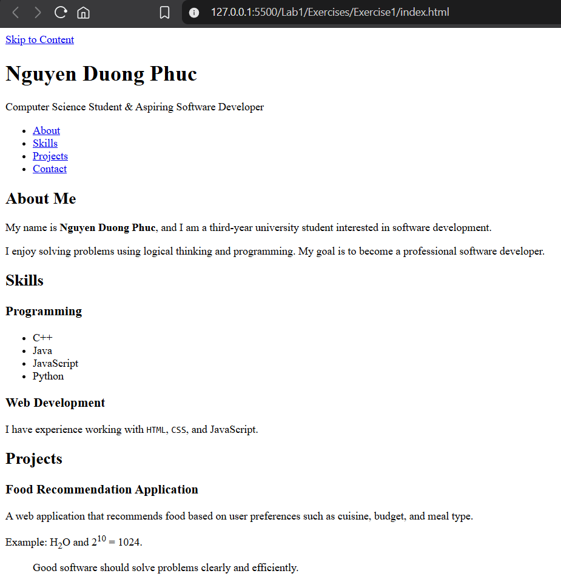
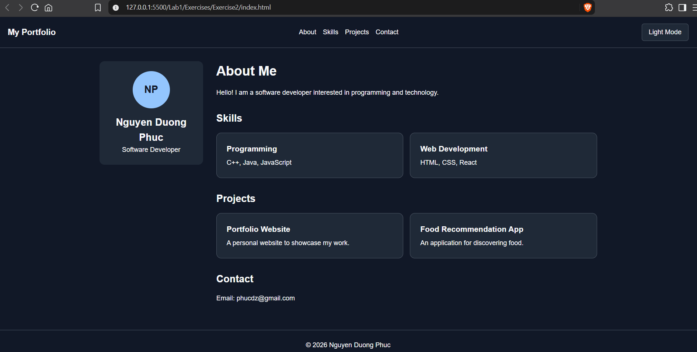
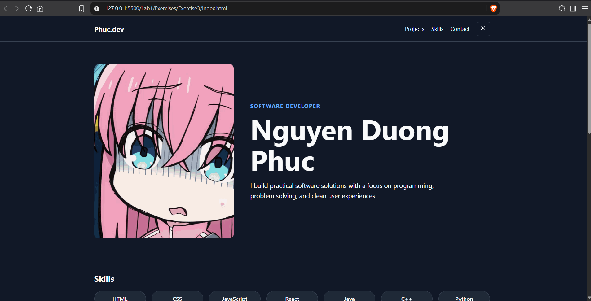
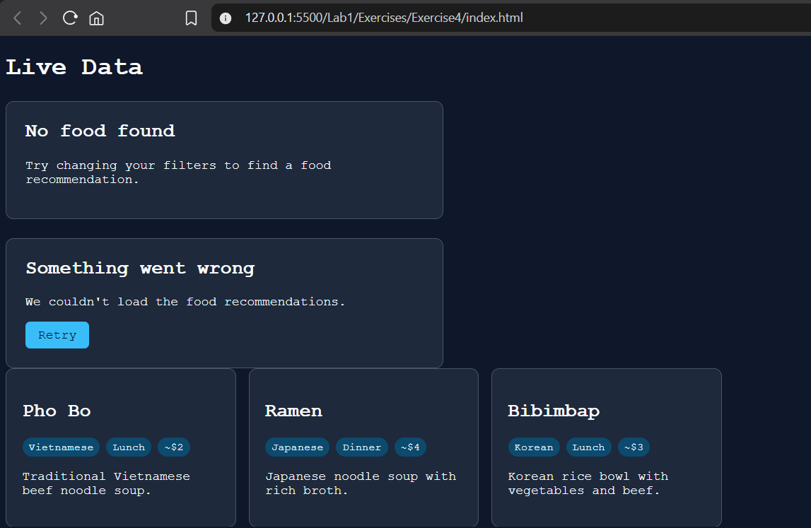

# Lab 1 - Web Development Exercises

This lab focuses on building modern, accessible, responsive, and maintainable web interfaces using HTML5, CSS3, and JavaScript.

The four exercises cover semantic HTML architecture, responsive portfolio design, modular components, and resilient UI state management.

---

## Exercise 1 - Semantic DOM Architecture & Accessibility

This exercise focuses on building an accessible webpage using semantic HTML5 elements instead of unnecessary `
` containers.

**Key Features:**

- Semantic landmark hierarchy using HTML5 elements.
- Zero `
` elements in the document structure.
- Accessible "Skip to Content" navigation link.
- Clear document structure for screen readers.
- Accessibility verification using Chrome DevTools.

**Technologies:** HTML5, ARIA, Chrome DevTools

### Preview

**[View Source Code](./Exercise1/)**

---

## Exercise 2 - Enterprise Developer Portfolio

A responsive developer portfolio demonstrating modern CSS architecture, adaptive layouts, and interactive theme management.

**Key Features:**

- Reusable CSS design tokens and reset styles.
- Responsive two-dimensional CSS Grid layout.
- Interactive light and dark theme switching.
- Theme persistence using `localStorage`.
- Accessible keyboard navigation.
- Performance-oriented layout design.

**Technologies:** HTML5, CSS3, JavaScript, CSS Grid, localStorage

### Preview

**[View Source Code](./Exercise2/)**

---

## Exercise 3 - Component Architecture & State Modeling

This exercise demonstrates how to organize a developer portfolio into reusable, independent interface components.

**Key Features:**

- Hero section with portrait, headline, and introduction.
- Accessible theme switcher with `aria-pressed`.
- Categorized skills matrix using CSS Grid.
- Project cards with descriptions, tags, and links.
- Contact form with native validation and client-side state handling.
- Modular JavaScript architecture for maintainability.

**Technologies:** HTML5, CSS3, JavaScript, CSS Grid

### Preview

**[View Source Code](./Exercise3/)**

---

## Exercise 4 - Resilient Component Architecture

A resilient user interface designed to handle asynchronous data and different application states while maintaining accessibility and usability.

**Key Features:**

- Four UI states: Loading, Success, Empty, and Error.
- Animated loading skeleton using CSS shimmer effects.
- Responsive data presentation with Flexbox and CSS Grid.
- Accessible empty-state and error-state messages.
- Interactive retry functionality for failed operations.
- State-based rendering for consistent user experiences.

**Technologies:** HTML5, CSS3, CSS Grid, Flexbox, JavaScript

### Preview

**[View Source Code](./Exercise4/)**

---

## Learning Outcomes

Through these exercises, the following concepts are practiced:

- Semantic HTML and web accessibility.
- Responsive web design and CSS architecture.
- Component-based interface development.
- JavaScript state management and user interactions.
- Performance optimization and resilient UI design.
