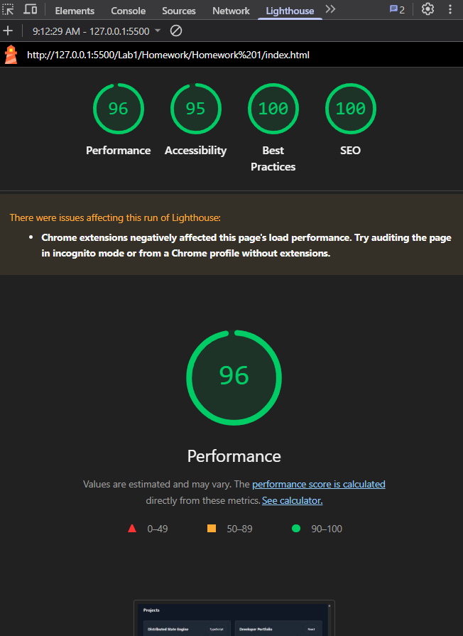
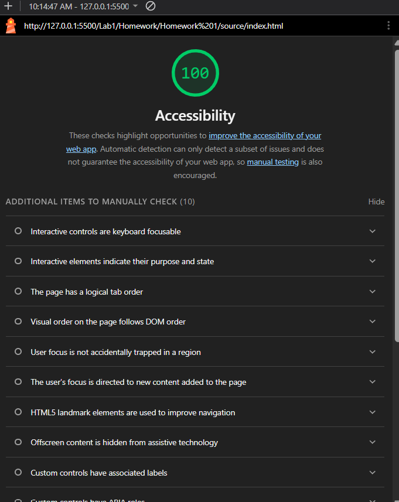
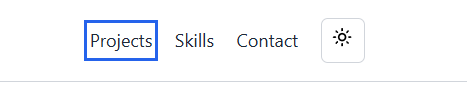
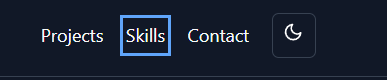
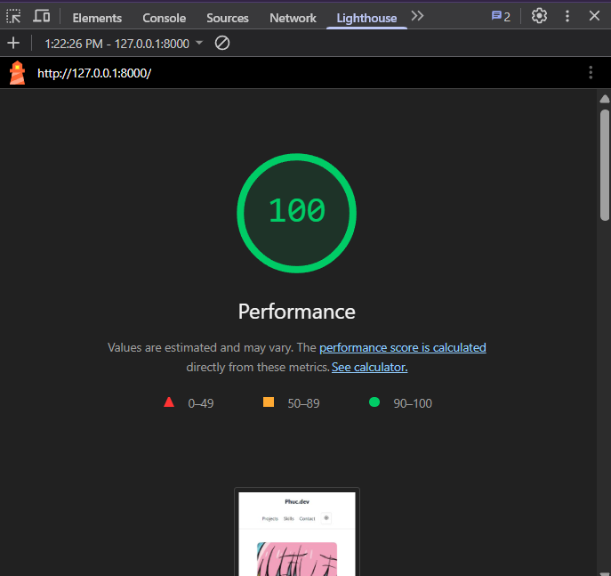

# HW1 — Production Portfolio: Task Decomposition

## 1. Objective

Build and improve a portfolio website with a focus on accessibility, keyboard navigation, security, and performance.

The implementation must follow small, atomic milestones with separate commits. All changes must be tested and verified before being marked complete.

## 2. Development Rules

- Work on one milestone at a time.
- Inspect the existing project before modifying code.
- Keep each commit focused on a specific change.
- Test each milestone before moving to the next.
- Do not combine all changes into one large commit.
- Record actual test results and update progress honestly.

## 3. Milestones

## M0 — Project Inspection and Baseline

**Tasks**

- [x] Inspect the repository structure and existing source code.
- [x] Identify the website sections, navigation, interactive elements, and assets.
- [x] Identify how to run the website and inspect its behavior.
- [x] Test basic keyboard navigation and browser loading behavior.
- [x] Run Lighthouse and record the initial results.
- [x] Save a screenshot of the baseline results.

**Project Structure**

The project uses Exercise 3 as its starting point. It is built with HTML, CSS, and vanilla JavaScript.

```text
Homework 1/
├── TASK_DECOMPOSITION.md
├── source/
│   ├── index.html
│   ├── css/
│   │   └── style.css
│   ├── js/
│   │   └── app.js
│   └── images/
│       └── angry.jpg
└── screenshots/
    └── lighthouse-baseline.png
```

**Initial Findings**

- The website contains a navigation bar, hero section, skills section, projects section, contact form, and footer.
- Interactive features include a theme toggle and contact form.
- The website uses HTML, CSS, and vanilla JavaScript without a frontend framework.
- The browser Console and Network panel were inspected during the initial test.
- Basic keyboard navigation using the Tab key was tested.

**Baseline Lighthouse Results**

The Lighthouse audit was run in a Chrome Incognito window to reduce potential interference from browser extensions.

| Category | Score |
|---|---:|
| Performance | 100 |
| Accessibility | 100 |
| Best Practices | 100 |
| SEO | 100 |

An earlier Performance audit scored 90 in the regular Chrome profile. The score may have been affected by browser extensions, so the Incognito result is used as the baseline for subsequent comparisons.

**Initial Assessment**

The Lighthouse results indicate strong baseline scores across all four categories. However, Lighthouse scores alone do not prove that every accessibility, keyboard navigation, or security requirement has been satisfied.

The following milestones will verify the specific requirements and address any issues identified during testing.

**Baseline Evidence**



**Acceptance Criteria**

- [x] The existing project structure is documented.
- [x] The website can be run and its basic behavior has been checked.
- [x] Initial Lighthouse scores are recorded.
- [x] The baseline screenshot is saved.

**Commit**

`docs: document project inspection and baseline audit`

### M1: WCAG 2.2 AA Audit

**Changes**
- Added visible focus indicators for keyboard navigation.
- Improved text contrast for the Send Message button in dark mode.

**Verification**
- Lighthouse Accessibility score: 100.
- Checked six foreground/background color pairs using WebAIM Contrast Checker. All pairs passed WCAG AA requirements for normal text.
- Tested keyboard navigation using Tab and Shift + Tab in both light and dark themes.
- Verified that focus indicators were visible on interactive elements in both themes.

**Evidence**

Lighthouse Accessibility report:



Keyboard focus in light theme:



Keyboard focus in dark theme:



**Acceptance Criteria**
- [x] Tested text color contrast meets WCAG AA requirements.
- [x] Interactive elements are keyboard accessible.
- [x] Focus indicators are visible in both themes.
- [x] Lighthouse Accessibility score is 100.

### M2: Keyboard Focus Audit / Prevention

**Audit**
- Tested keyboard navigation through the logo, navigation links, theme toggle, and contact form.
- Verified that the theme toggle works with Enter and Space.
- Tested form validation using the keyboard.
- Verified forward and backward keyboard navigation using Tab and Shift + Tab.
- No keyboard traps were found during manual testing.

**Verification**
- All tested interactive elements were keyboard accessible.
- Focus indicators remained visible during keyboard navigation.
- Lighthouse Accessibility score remained 100.

**Result**
- No keyboard navigation issues were found during the audit.
- No JavaScript changes were required.

**Acceptance Criteria**
- [x] Interactive elements can be operated using the keyboard.
- [x] Focus moves forward and backward as expected.
- [x] No keyboard traps were found during manual testing.

### M3: Strict Content Security Policy

**Changes**
- Added a Content Security Policy using a meta tag.
- Restricted scripts and styles to the same origin.
- Disallowed plugin content and restricted resource loading.
- Kept JavaScript in the external `js/app.js` file.
- Removed no inline handlers because none were present in the inspected HTML.

**Verification**
- Tested the website using Python's HTTP server.
- Verified that the page loads without CSP errors.
- Verified the theme toggle and contact form.
- Confirmed that the CSP remains enabled without `unsafe-inline`.

**Acceptance Criteria**
- [x] CSP is configured.
- [x] No inline JavaScript handlers are present in the inspected HTML.
- [x] Main interactions work with CSP enabled.
- [x] No CSP errors occur during testing.

**Note:** The browser may report a missing `favicon.ico` if no favicon is provided.

### M4: Performance Optimization

**Objective**
- Evaluate the portfolio's loading performance using Lighthouse.
- Identify performance issues without changing the existing design or functionality.

**Tasks**
- Run a Lighthouse Performance audit.
- Review image sizes, resource loading, and Lighthouse recommendations.
- Apply optimizations only if the audit identifies meaningful issues.
- Verify the final result using Lighthouse.

**Evidence**
**Evidence**



**Acceptance Criteria**
- [ ] Lighthouse Performance score is recorded.
- [ ] Performance recommendations are reviewed.
- [ ] The website's existing appearance and functionality are preserved.

**Result**
- Lighthouse Performance score: 100.
- No further optimization was necessary based on the audit results.

## 4. Final Verification

- [x] Run the available build and test commands.
- [x] Recheck the accessibility fixes from M1 using Lighthouse and contrast checks.
- [x] Recheck keyboard navigation and focus behavior from M2.
- [x] Verify the CSP and absence of inline event handlers.
- [x] Record the final Lighthouse results.
- [x] Review the Git history to confirm that milestones were committed separately.

## 5. Definition of Done

A milestone is complete only when:

1. Its implementation matches the task requirements.
2. Its acceptance criteria have been checked.
3. Relevant tests or manual verification have been performed.
4. Its changes have been committed separately.
5. The commit message accurately describes the changes.
6. This document reflects the actual completion status.

## 6. Progress Tracker

| Milestone | Status |
| --- | --- |
| M0 — Project Inspection and Baseline | Complete |
| M1 — WCAG 2.2 AA Audit | Complete |
| M2 — Keyboard Focus Audit | Complete |
| M3 — Strict CSP | Complete |
| M4 — Lighthouse Performance Audit | Complete |
| Final Verification | Complete |