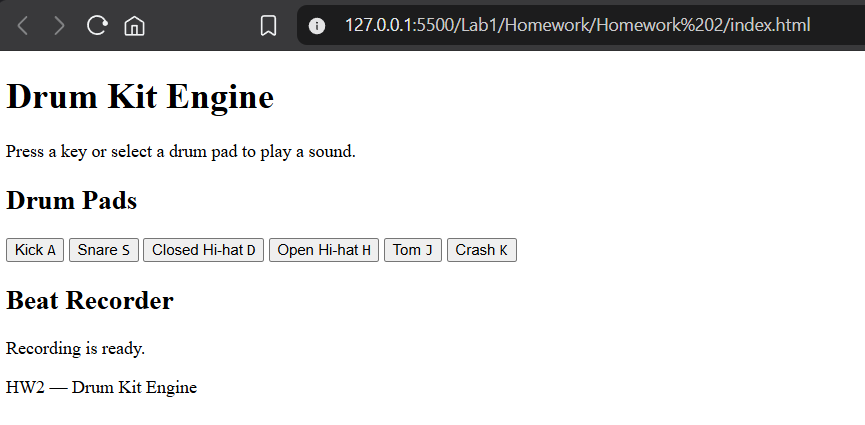
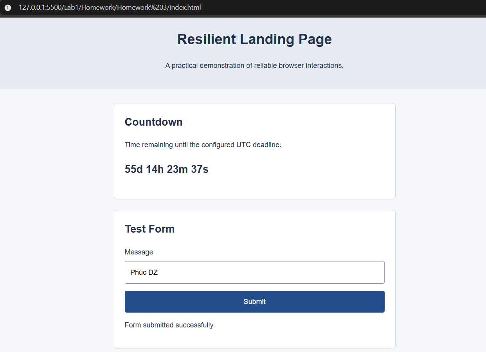

# Lab 1 - Web Development Homework

This lab focuses on developing production-oriented web applications using HTML5, CSS3, and JavaScript.

The three homework assignments explore web accessibility, interactive audio systems, asynchronous state management, and resilient application architecture.

---

## Homework 1 - Production Portfolio

An enhanced developer portfolio focusing on accessibility, security, performance optimization, and production-ready web development practices.

**Key Features:**

- Semantic HTML5 structure and accessible landmark navigation.
- WCAG 2.2 AA accessibility improvements.
- Keyboard navigation and focus management.
- Content Security Policy (CSP) with no inline JavaScript event handlers.
- Optimized assets and performance auditing with Lighthouse.
- Responsive layouts and accessible light/dark themes.

**Technologies:** HTML5, CSS3, JavaScript, WCAG 2.2, Lighthouse, Chrome DevTools

### Preview

**[View Source Code](./Homework%201/)**

---

## Homework 2 - Web Audio Drum Kit Engine

An interactive browser-based drum kit demonstrating modular JavaScript architecture, polyphonic audio playback, keyboard event handling, and beat recording.

**Key Features:**

- Interactive drum pads controlled by mouse and keyboard.
- Polyphonic audio playback supporting overlapping sounds.
- HTML `data-sound` attributes for sound mapping.
- Keyboard event handling with `event.repeat` protection.
- FIFO beat recorder with timestamped events.
- Modular audio engine and keyboard controller.
- Configurable key bindings for improved maintainability.

**Technologies:** HTML5, JavaScript, Web Audio API, DOM Events

### Demo

**[View Source Code](./Homework%202/)**

---

## Homework 3 - Resilient Event Hub & AI Failure Audit

A resilient event landing page featuring accurate countdown timing, state-driven form interactions, and secure input handling.

**Key Features:**

- Drift-free countdown engine using UTC ISO 8601 timestamps.
- Accurate time calculations independent of interval drift.
- Form state machine with Idle, Submitting, Success, and Error states.
- Prevention of duplicate form submissions.
- Input validation and sanitization to reduce XSS risks.
- Modular JavaScript architecture and event handling.
- AI failure auditing with documented defects, diagnostic methods, and verified fixes.

**Technologies:** HTML5, CSS3, JavaScript, Date API, DOM APIs

### Demo

**[View Source Code](./Homework%203/)**

---

## Learning Outcomes

Through these homework assignments, the following skills are developed:

- Building accessible and responsive web applications.
- Applying web security and performance optimization practices.
- Developing modular JavaScript systems.
- Implementing interactive audio and keyboard controls.
- Managing asynchronous UI states and user interactions.
- Preventing common client-side security and state-management issues.
- Debugging, reviewing, and refactoring AI-generated code.
- Practicing atomic Git commits and structured task decomposition.
