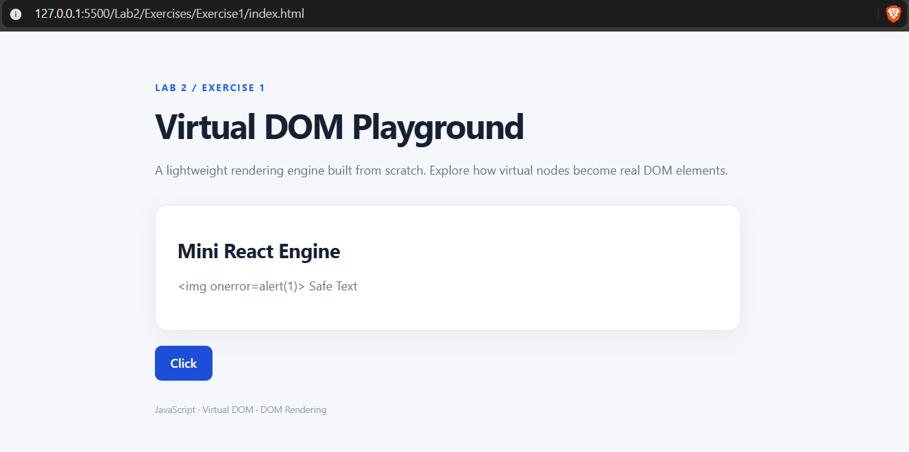
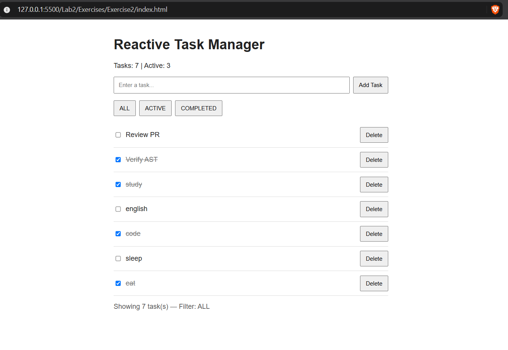
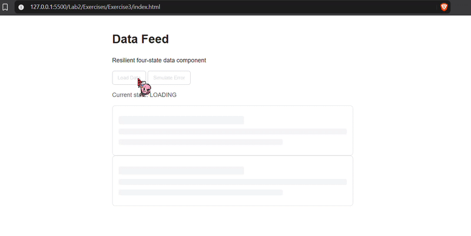

# Lab 2 - Web Development Exercises

This lab focuses on understanding the fundamental architecture behind modern reactive JavaScript frameworks.

The three exercises explore Virtual DOM rendering, reactive state management, event delegation, and resilient asynchronous UI components.

---

## Exercise 1 - Mini-React VNode & Mounting Engine

A lightweight Virtual DOM rendering engine built from scratch to demonstrate how React-like frameworks create and mount user interfaces.

**Key Features:**

- Custom `createElement()` factory for creating Virtual Nodes (VNodes).
- Text node generation using `createTextElement()`.
- Recursive DOM rendering with `renderToDOM()`.
- Semantic HTML elements without unnecessary `
` containers.
- Safe text rendering to prevent HTML injection and XSS.
- Virtual DOM structure verification using Chrome DevTools.
- Automated rendering checks with `test-runner.js`.

**Technologies:** JavaScript (ES6+), HTML5, DOM API, Virtual DOM

### Preview

**[View Source Code](./Exercise1/)**

---

## Exercise 2 - Reactive State Machine & Event Delegation

A custom reactive state management system inspired by React's `useState`, demonstrated through an interactive Task Manager application.

**Key Features:**

- Custom `useState()` implementation using JavaScript closures.
- Centralized state storage with cursor-based hook tracking.
- Automatic UI re-rendering after state updates.
- Root-level event delegation for efficient event handling.
- Interactive Task Manager with dynamic task updates.
- Task filtering and reactive UI controls.
- Unidirectional data flow and event listener management.
- State and event verification using `checkpoint2-verify.js`.

**Technologies:** JavaScript (ES6+), HTML5, DOM API, Closures, Event Delegation

### Demo

**[View Source Code](./Exercise2/)**

---

## Exercise 3 - Resilient State Machine & Skeleton Loader

A fault-tolerant asynchronous data component designed to manage loading, success, and failure scenarios through a predictable finite state machine.

**Key Features:**

- Four-state lifecycle: `IDLE`, `LOADING`, `SUCCESS`, and `ERROR`.
- Explicit state transitions for asynchronous data operations.
- Animated CSS skeleton loader during data fetching.
- Dynamic content rendering after successful requests.
- Human-readable error messages.
- Accessible "Retry Connection" functionality.
- Race-condition prevention and consistent UI state management.
- Responsive interface using modern CSS.

**Technologies:** JavaScript (ES6+), HTML5, CSS3, Async/Await, Finite State Machines

### Demo

**[View Source Code](./Exercise3/)**

---

## Learning Outcomes

Through these exercises, the following concepts are explored:

- Understanding Virtual DOM architecture and rendering.
- Building custom React-like rendering mechanisms.
- Implementing reactive state management with JavaScript closures.
- Applying unidirectional data flow principles.
- Optimizing event handling through event delegation.
- Designing predictable finite state machines.
- Managing asynchronous operations and error recovery.
- Building accessible and resilient user interfaces.
- Practicing modular architecture and atomic Git commits.
