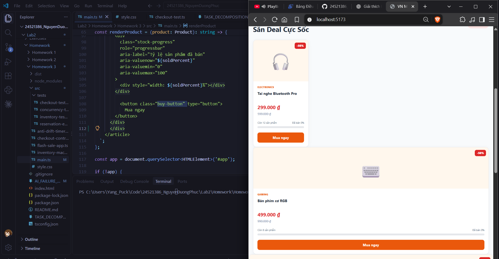
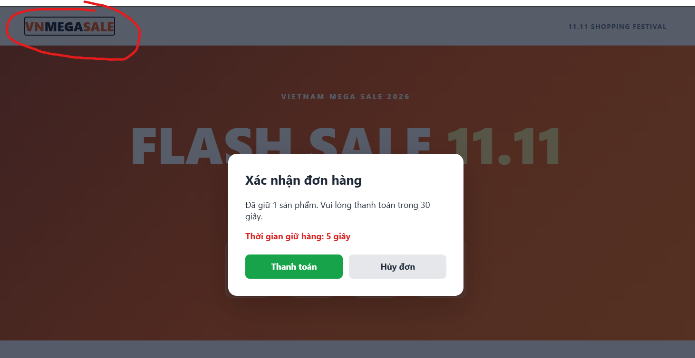

## Failure 1 — Extra Closing HTML Tag in Product Card

- **AI Suggestion:** AI generated the `renderProduct()` HTML template for the Flash Sale product cards.
- **Failure:** The generated HTML contained an extra closing `</div>` before `</article>`.
- **Impact:** The browser automatically corrected the invalid HTML structure, causing product cards to display inconsistently. Some cards appeared narrow, while others stretched across the available width.
- **Correction:** Removed the redundant `</div>` from `src/main.ts` and kept the correct HTML structure:

  ```html
  <button class="buy-button" type="button">
    Mua ngay
  </button>
  </div>
  </article>
  ```

- **Verification:** Reloaded the website and confirmed that all four product cards displayed correctly in the product grid. The M5 checkout tests continued to pass after the correction.
- **Evidence:** 

## Failure 2 — Missing Keyboard Focus Management in Checkout Modal

- **AI Suggestion:** AI generated a checkout modal with `role="dialog"`, `aria-modal="true"`, and initial focus on the checkout button.
- **Failure:** The modal did not implement a focus trap or restore focus when closed.
- **Cause:** The implementation focused only on opening and closing the modal without managing keyboard navigation.
- **Impact:** Keyboard users could navigate to elements behind the open checkout modal, creating an accessibility problem.
- **Correction:** Added keyboard event handling to keep Tab and Shift+Tab navigation inside the modal, support Escape to cancel, and restore focus to the original Buy button.
- **Verification:** Tested keyboard navigation before and after the correction. After fixing the issue, focus remained inside the modal and returned to the original Buy button when the modal closed.
- **Evidence:** `screenshots/failure-2-after.png`



## Failure 3 — Focus Lost After Final Stock Checkout

- **AI Suggestion:** AI generated the `closeOrder()` function in `src/flash-sale-app.ts` to close the checkout modal and restore keyboard focus to the original Buy button.
- **Failure:** The original implementation restored focus before updating the inventory state and disabling sold-out buttons.
- **Cause:** The function called `previousFocus.focus()` before `refreshStock()`. When the last available product was purchased, the Buy button subsequently became disabled, potentially causing keyboard focus to be lost.
- **Impact:** Keyboard users could lose their current navigation position after completing a purchase, reducing accessibility and making it harder to continue interacting with the page.
- **Correction:** Reordered `closeOrder()` to call `refreshStock()` before restoring focus. The corrected implementation checks whether the original button is still enabled. If not, it moves focus to another available Buy button or the main content.
- **Verification:** The initial inspection returned `isBody: true`, indicating that focus was on the document body. This observation alone did not establish the cause because DevTools can affect focus. After applying the correction, keyboard navigation and the focus restoration behavior should be retested using a log inside `closeOrder()`.

## Final Summary

This audit examined three accessibility and implementation issues introduced during AI-assisted development.

| Failure | Root Cause | Correction |
|---|---|---|
| 1. Extra Closing HTML Tag | Incorrect HTML nesting in the product card template | Removed the redundant `</div>` |
| 2. Missing Modal Focus Management | Keyboard focus was not constrained to the checkout dialog | Added Tab/Shift+Tab handling, Escape support, and focus restoration |
| 3. Focus Lost After Final Checkout | Focus restoration occurred before sold-out buttons were disabled | Updated inventory state before restoring focus and added a fallback focus target |

### Lessons Learned

1. AI-generated HTML must be inspected for valid DOM structure.
2. Accessibility requires keyboard testing, not just visual inspection.
3. UI state updates and focus restoration must occur in the correct order.
4. Automated tests should be combined with manual browser verification.
5. AI-generated solutions require independent validation before submission.

### Conclusion

AI-assisted development accelerated implementation, but human review and testing were necessary to identify and correct defects. The project demonstrates the importance of validating AI-generated code through functional, accessibility, and state-consistency checks.