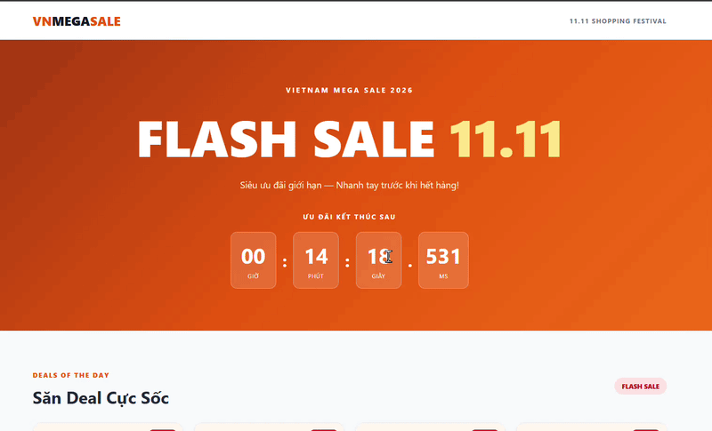

# Flash Sale 11.11 — High-Concurrency E-Commerce Engine

## 1. Project Overview

A Flash Sale 11.11 e-commerce simulation built with Vite, TypeScript, HTML, and CSS.

The project demonstrates countdown timing, inventory state management, temporary stock reservations, checkout lifecycle handling, and simulated concurrent purchase requests.

## 2. Technologies

- TypeScript
- Vite
- HTML5
- CSS3
- Browser DOM APIs

## 3. Main Features

### Flash Sale Interface
- Responsive product grid
- Product prices, discounts, and inventory information
- Interactive Buy buttons

### Anti-Drift Countdown
- Countdown based on `Date.now()`
- UI updates using `requestAnimationFrame`
- Timer cancellation and cleanup

### Inventory State Machine
- Reservation states: `RESERVED`, `RELEASED`, `PURCHASED`, `EXPIRED`
- Inventory conservation invariant
- Rejection of invalid state transitions

### Reservation Lock
- Temporary 30-second stock reservation
- Expiration checks using timestamps
- Automatic stock restoration when expired reservations are processed

### Checkout Controller
- Product reservation
- Successful checkout
- Order cancellation
- Expired-order rejection
- Inventory updates

### Concurrency Simulation
- 100 simulated reservation attempts competing for 5 units
- Duplicate checkout rejection
- Checkout/cancel race simulation
- Overselling prevention within one JavaScript runtime

## 4. Project Structure

```text
src/
├── main.ts
├── style.css
├── anti-drift-timer.ts
├── inventory-machine.ts
├── checkout-controller.ts
├── flash-sale-app.ts
└── tests/
    ├── inventory-test.ts
    ├── reservation-expiry-test.ts
    ├── checkout-test.ts
    └── concurrency-test.ts
```

## 5. Installation

Requirements: Node.js and npm.

```bash
npm install
npm run dev
```

Open the local URL displayed by Vite.

## 6. Build

```bash
npm run build
```

## 7. Testing

Development tests run in the browser Console.

1. Start the development server.
2. Open the website.
3. Press F12 and select Console.
4. Review the M3, M4, M5, and M6 test results.

Additional manual checks:
- Responsive product cards
- Countdown behavior
- Checkout and cancellation
- Reservation expiration
- Keyboard focus management

## 8. Technical Limitations

This project is a client-side simulation, not a production e-commerce backend.

- Inventory is stored in browser memory and resets after page reload.
- Separate browser sessions do not share inventory.
- `Promise.all()` tests asynchronous scheduling within a single JavaScript runtime; it does not simulate distributed server concurrency.
- Real payment processing is not implemented.
- Production overselling prevention would require backend-side atomic transactions or equivalent concurrency control.
- Reservation expiration is evaluated during inventory operations and periodic checks while the checkout dialog is active.

## 9. AI Failure Mode Audit

See [AI_FAILURE_AUDIT.md](AI_FAILURE_AUDIT.md) for documented AI-generated implementation flaws, corrections, and verification evidence.

## 10. Milestones

- M0 - Project Initialization
- M1 - Flash Sale Interface
- M2 - Anti-Drift Timer
- M3 - Inventory State Machine
- M4 - Reservation Lock & Expiry
- M5 - Checkout Controller
- M6 - Concurrency Testing
- M7 - AI Failure Mode Audit & Documentation

## Demo

