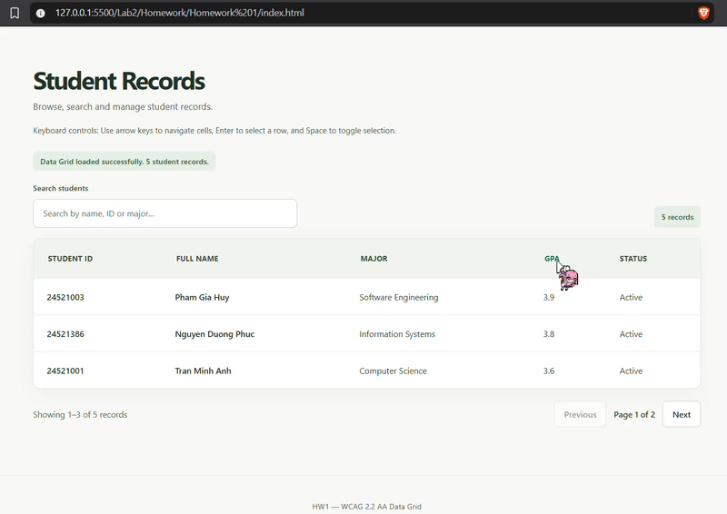
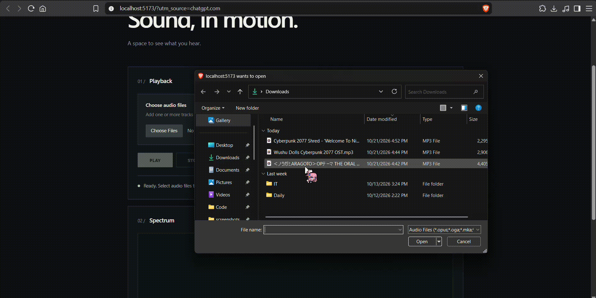
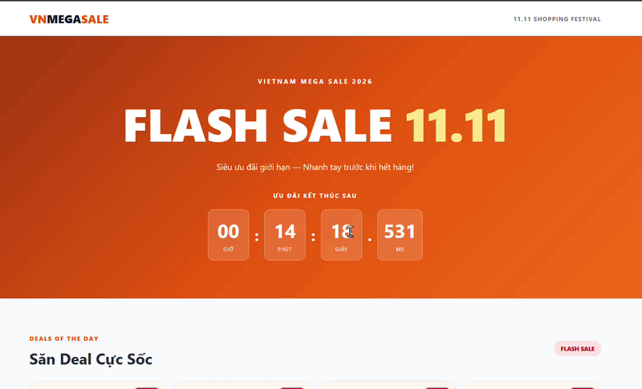

# Lab 2 - Web Development Homework

This lab focuses on developing production-oriented web applications with advanced JavaScript and TypeScript architecture.

The three homework assignments explore accessible data management, asynchronous audio processing, concurrency control, and resilient e-commerce systems.

---

## Homework 1 - Production Enterprise Data-Grid

An accessible, enterprise-style Data-Grid component designed for efficient data management, keyboard navigation, and responsive user interaction.

**Key Features:**

- Interactive data table with sorting, filtering, and pagination.
- Semantic HTML table structure using `<table>`, `<thead>`, `<tbody>`, and `<th>`.
- ARIA grid semantics for assistive technologies.
- Keyboard navigation using arrow keys.
- Row selection using Enter and Space.
- Accessibility-focused design targeting WCAG 2.2 Level AA.
- Color contrast and screen reader support.
- Lighthouse Accessibility and Best Practices auditing.
- Reusable, type-safe data-grid component contract.

**Technologies:** HTML5, CSS3, JavaScript, TypeScript, ARIA, Lighthouse

### Demo

**[View Source Code](./Homework%201/)**

---

## Homework 2 - Concurrent FIFO Audio Visualizer Queue Engine

An interactive audio processing system demonstrating asynchronous task scheduling, FIFO queue management, and real-time audio frequency visualization.

**Key Features:**

- Web Audio API integration for audio playback and processing.
- FIFO task queue for sequential audio loading and decoding.
- Audio frequency analysis using `AnalyserNode` and FFT.
- Real-time audio visualization using Canvas or SVG.
- Smooth animation driven by `requestAnimationFrame`.
- Asynchronous task cancellation using `AbortController`.
- Explicit audio resource cleanup and memory management.
- Modular TypeScript architecture for queue and audio processing.

**Technologies:** TypeScript, Vite, Web Audio API, Canvas/SVG, Async/Await, AbortController

### Demo

**[View Source Code](./Homework%202/)**

---

## Homework 3 - High-Concurrency Flash-Sale E-Commerce Engine

A Vietnam-inspired flash-sale e-commerce simulation demonstrating precise countdown timing, inventory state management, and concurrent checkout operations.

**Key Features:**

- Interactive flash-sale interface inspired by major Vietnamese e-commerce campaigns.
- Anti-drift countdown timer using `Date.now()` and `requestAnimationFrame`.
- Product listings with pricing, discounts, and stock availability.
- Inventory state machine for stock reservation and checkout.
- Temporary inventory locks with expiration handling.
- Concurrent purchase simulation and overselling prevention within a single JavaScript runtime.
- Order cancellation and inventory restoration.
- AI failure auditing with documented defects and engineering fixes.
- Modular application architecture and automated logic tests.

**Technologies:** TypeScript, Vite, HTML5, CSS3, JavaScript, Finite State Machines

### Demo

**[View Source Code](./Homework%203/)**

---

## Learning Outcomes

Through these homework assignments, the following skills are developed:

- Building accessible, keyboard-friendly data interfaces.
- Applying semantic HTML and ARIA accessibility practices.
- Implementing sorting, filtering, and pagination.
- Managing asynchronous operations with FIFO queues.
- Processing and visualizing audio data using the Web Audio API.
- Handling cancellation and resource cleanup.
- Designing finite state machines for complex application logic.
- Implementing precise countdown timers and inventory reservation systems.
- Testing concurrency behavior and preventing invalid state transitions.
- Auditing AI-generated code and applying structured debugging practices.
- Maintaining modular architecture with atomic Git commits.
