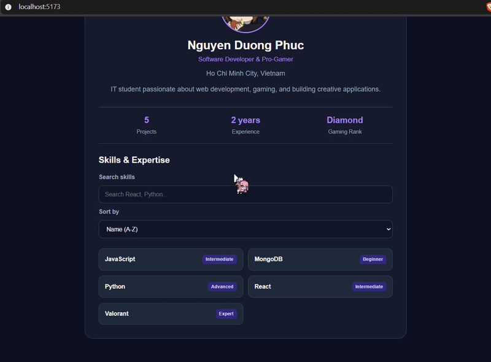
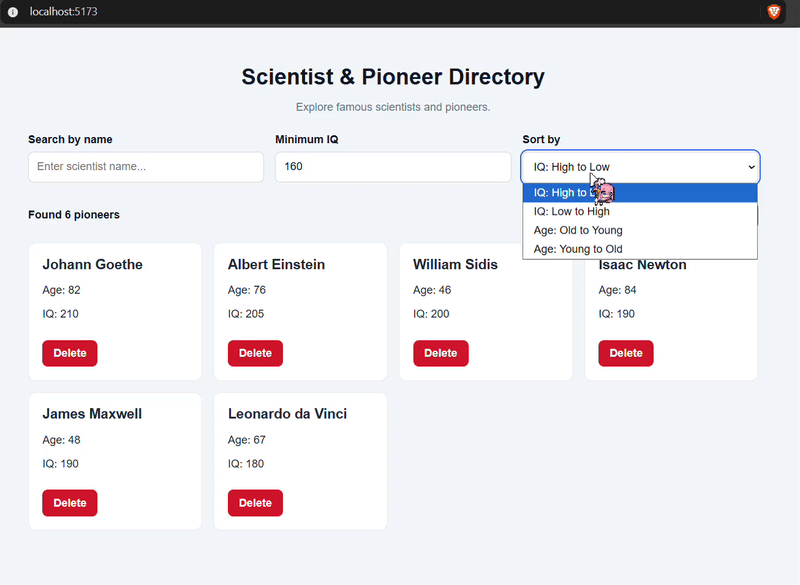
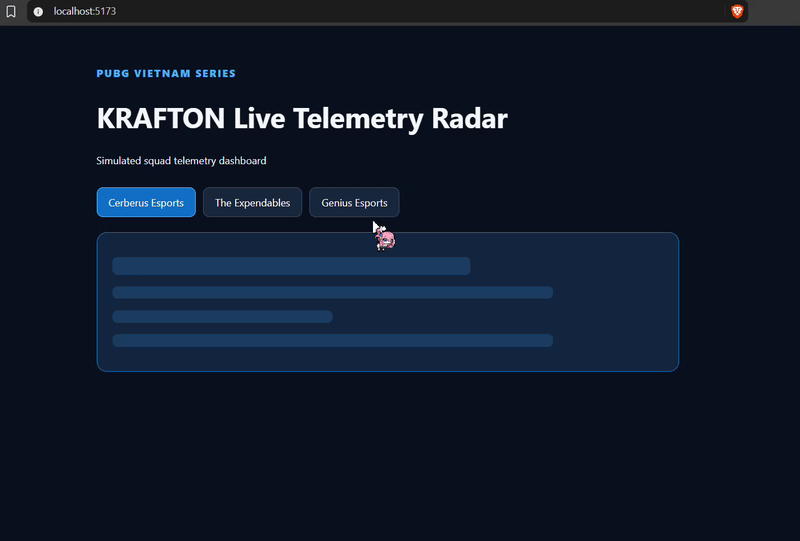

# React Lab 3 - Advanced Component Engineering

A collection of three React 19 exercises focusing on **semantic HTML, accessibility, state management, responsive design, and asynchronous programming**.

Built with **React 19 + Vite**, these exercises demonstrate practical frontend engineering concepts through interactive components.

## Tech Stack

- **React 19** – Functional components and React Hooks
- **Vite** – Development server and production builds
- **JavaScript (ES6+)** – Modern JavaScript features
- **CSS Modules** – Scoped component styling
- **HTML5** – Semantic and accessible markup
- **AbortController** – Asynchronous request cancellation
- **Chrome / Brave DevTools** – Debugging and performance inspection

---

## Exercise 1 - Semantic Engineer & Pro-Gamer Profile Card

A responsive developer profile card built using semantic HTML and reusable React components.

### Demo



### Features

- Reusable `DeveloperCard` and `SkillBadge` components
- Semantic HTML structure without `<div>` elements inside `DeveloperCard`
- Developer information, performance metrics, and skill badges
- CSS Modules with custom properties
- Responsive layout supporting 375px mobile screens
- HTTPS avatar with explicit image dimensions and fallback initials
- Accessible structure using `aria-labelledby`, `<dl>`, and `<ul>`

### Key Concepts

- Component composition
- Props and default parameters
- Rendering lists with stable keys
- React Fragments
- Semantic HTML and accessibility
- Responsive design

---

## Exercise 2 - Interactive Scientist & Pioneer Directory

An interactive directory for exploring historical scientists and pioneers using React state and derived data.

### Demo



### Features

- Case-insensitive name search
- Minimum IQ filtering
- Sorting by IQ and age
- Delete individual records
- Reset the directory to its initial dataset
- Dynamic result counter with `aria-live="polite"`
- Accessible form controls using `useId()`
- Stable identifiers for efficient React reconciliation

### Key Concepts

- `useState()` and `useId()`
- Controlled form inputs
- Derived state without unnecessary `useEffect()`
- Immutable state updates
- Array `.filter()` and `.toSorted()`
- React reconciliation and stable keys

### Data Flow

```text
User Input
    |
    v
React State
    |
    v
Filter by Name
    |
    v
Filter by Minimum IQ
    |
    v
Sort by IQ / Age
    |
    v
Render Scientist List
    |
    v
Update Result Counter
```

Filtering and sorting are calculated directly from state instead of storing redundant derived data.

---

## Exercise 3 - PUBG Vietnam Series Live Telemetry

A simulated esports telemetry dashboard inspired by the PUBG Vietnam competitive scene.

The application displays squad statistics while demonstrating asynchronous operations, error handling, and request cancellation.

### Demo



### Features

- Squad selection:
  - Cerberus Esports (CES)
  - The Expendables (TE)
  - Genius Esports (GE)
- Simulated match telemetry:
  - Map and match phase
  - Players alive
  - Total kills
  - Estimated WWCD probability
  - Squad status
- Four asynchronous states: `IDLE`, `LOADING`, `SUCCESS`, and `ERROR`
- 220px Blue-Zone skeleton loading animation
- Simulated 35% packet loss
- `AbortController` for canceling stale requests
- Retry mechanism for failed telemetry requests
- Accessible error messages using `role="alert"`
- No blocking `window.alert()` dialogs

### Key Concepts

- `useState()` and `useEffect()`
- Asynchronous operations
- Effect cleanup
- `AbortController`
- Loading and error states
- Conditional rendering
- Fault-tolerant UI design

### Request Lifecycle

```text
Select Squad
     |
     v
LOADING
     |
     v
Simulated Request
     |
     +------ Success ------> SUCCESS
     |
     +------ Failure ------> ERROR
     |                         |
     |                         v
     |                        Retry
     |                         |
     +<------------------------+
     |
     +------ Squad Changed
                 |
                 v
          Abort Old Request
                 |
                 v
          Start New Request
```

The telemetry data is simulated for educational purposes and does not represent actual live PUBG match statistics.

---

## Getting Started

### Prerequisites

- Node.js
- npm

### Installation

Clone the repository and navigate to the corresponding exercise directory.

```bash
npm install
```

Start the development server:

```bash
npm run dev
```

Open the local URL displayed in the terminal.

### Production Build

```bash
npm run build
```

Preview the production build:

```bash
npm run preview
```

---

## Engineering Highlights

| Concept             | Exercise 1 | Exercise 2 | Exercise 3 |
| ------------------- | :--------: | :--------: | :--------: |
| Reusable Components |     ✅     |     ✅     |     ✅     |
| Semantic HTML       |     ✅     |     ✅     |     ✅     |
| Accessibility       |     ✅     |     ✅     |     ✅     |
| Responsive UI       |     ✅     |     ✅     |     ✅     |
| React State         |     —      |     ✅     |     ✅     |
| Derived State       |     —      |     ✅     |     —      |
| Async Operations    |     —      |     —      |     ✅     |
| AbortController     |     —      |     —      |     ✅     |
| Error Recovery      |     —      |     —      |     ✅     |

---

## Learning Outcomes

Through these exercises, I practiced:

1. Designing reusable React components with semantic HTML.
2. Building responsive interfaces using CSS Modules.
3. Managing interactive state with React Hooks.
4. Applying derived-state patterns to avoid unnecessary effects.
5. Understanding React reconciliation and stable list keys.
6. Handling asynchronous operations and canceling stale requests.
7. Implementing accessible loading, status, and error feedback.

---

## Demo Assets

The animated demonstrations are stored in the `demos/` directory:

```text
demos/
├── exercise1.gif
├── exercise2.gif
└── exercise3.gif
```

---

## License

Created for educational purposes as part of React Lab 3.
