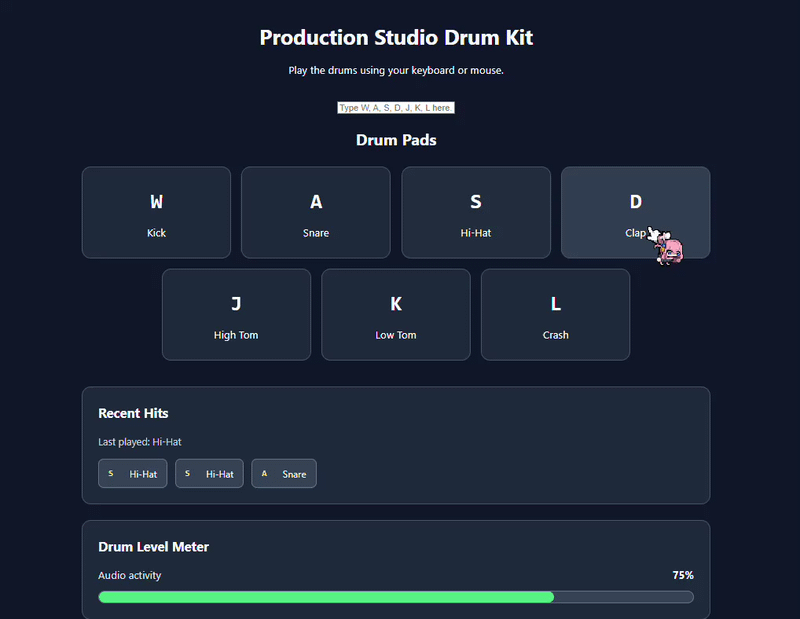
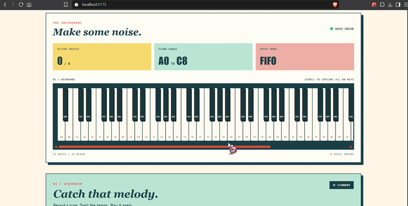
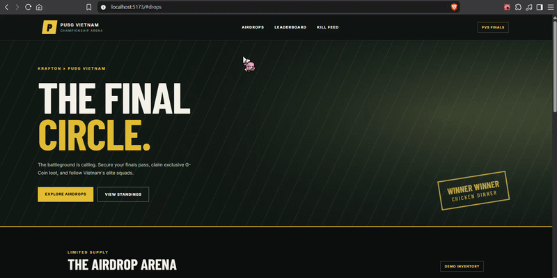

# Lab 3 - React Development Homework

This lab focuses on building production-oriented web applications using React 19, modern component architecture, accessibility engineering, and advanced state management.

The three homework assignments explore accessible musical interfaces, polyphonic audio synthesis, asynchronous FIFO sequencing, precise countdown timers, optimistic concurrency control, and interactive esports platforms.

---

## Homework 1 - Production Studio Drum Kit

An accessible, interactive drum kit application modernizing the legacy JavaScript Drum Kit with React components, keyboard event handling, audio playback, and visual accessibility features.

**Key Features:**

- Interactive seven-pad drum kit supporting keyboard and mouse input.
- Physical keyboard mapping using `KeyboardEvent.code` for W, A, S, D, J, K, and L.
- Anti-repeat protection using `event.repeat` to prevent unintended repeated sounds.
- Keyboard shortcut isolation when typing inside form controls.
- Web Audio playback with reusable audio management hooks.
- Accessible drum buttons using `aria-pressed` and visible focus indicators.
- Visual hit history with `aria-live="polite"` for deaf and hard-of-hearing users.
- Interactive decibel meter providing visual feedback during playback.
- Responsive drum pad layout optimized for desktop and mobile screens.
- Accessibility engineering targeting WCAG 2.2 Level AA.
- Lighthouse auditing across Performance, Accessibility, Best Practices, and SEO.
- Modular React architecture with reusable components and custom hooks.

**Technologies:** React 19, Vite, JavaScript, CSS3, Web Audio API, ARIA, Lighthouse

### Demo



**[View Source Code](./Homework%201/drum-studio/)**

---

## Homework 2 - 88-Key Polyphonic Piano & Concurrent FIFO Sequencer

An interactive 88-key digital piano demonstrating polyphonic audio synthesis, efficient React rendering, concurrent voice management, and asynchronous melody recording and playback.

**Key Features:**

- Full 88-key piano interface with interactive white and black keys.
- Polyphonic audio synthesis using the Web Audio API.
- Support for up to eight simultaneous active voices.
- O(1) active voice tracking using an ES6 `Map`.
- FIFO voice stealing that releases the oldest active note when the voice limit is reached.
- Click-free audio release using exponential gain envelope ramps.
- Memoized piano keys using `React.memo` to reduce unnecessary component re-renders.
- Interactive piano controls supporting pointer input.
- FIFO melody recording with MIDI note, frequency, duration, and timing information.
- Asynchronous sequence replay with adjustable playback speeds of 0.5x, 1.0x, and 2.0x.
- Playback cancellation using `AbortController`.
- Explicit oscillator cleanup and audio resource management.
- React DevTools Profiler analysis for rendering performance.
- Component-based architecture separating piano presentation, audio synthesis, and sequencing logic.

**Technologies:** React 19, Vite, JavaScript, CSS3, Web Audio API, React.memo, ES6 Map, Async/Await, AbortController

### Demo



**[View Source Code](./Homework%202/polyphonic-piano/)**

---

## Homework 3 - KRAFTON x PUBG Vietnam Championship & Airdrop Arena

A PUBG-inspired esports platform combining championship standings, real-time kill feed visualization, precise airdrop countdowns, and optimistic inventory management.

**Key Features:**

- Interactive esports arena inspired by PUBG Vietnam Championship.
- PUBG-themed interface featuring championship squads and airdrop rewards.
- Squad leaderboard displaying Winner Winner Chicken Dinner (WWCD), placement points, and kill points.
- Dynamic kill feed presenting match-related events.
- Anti-drift airdrop countdown based on absolute epoch timestamps.
- Timer synchronization using `Date.now()` and server clock offsets.
- Automatic countdown correction when returning to a background browser tab.
- Airdrop lifecycle management with `WARMUP`, `AIRDROP_LIVE`, `LOOTED_OUT`, and `EXPIRED` phases.
- Optimistic loot claiming with immediate inventory updates.
- In-flight claim locking to prevent duplicate submissions.
- Inventory rollback when a claim fails or receives an HTTP 409 conflict.
- Vietnamese currency formatting using `Intl.NumberFormat('vi-VN')`.
- Responsive esports dashboard with reusable React components.
- Mandatory `AI_FAILURE_AUDIT.md` documenting at least three AI-generated defects, their causes, and engineering fixes.
- Feature-based Git commits and structured implementation tracking.

**Technologies:** React 19, Vite, JavaScript, CSS3, React Hooks, Fetch API, AbortController, Optimistic UI, Finite State Machines

### Demo



**[View Source Code](./Homework%203/)**

---

## Learning Outcomes

Through these homework assignments, the following skills are developed:

- Building reusable and maintainable React 19 components.
- Applying semantic HTML and WCAG 2.2 accessibility principles.
- Implementing keyboard event handling with physical key codes.
- Preventing repeated keyboard events and shortcut conflicts.
- Developing accessible musical interfaces with visual feedback.
- Integrating browser audio capabilities through the Web Audio API.
- Managing polyphonic voices using efficient data structures.
- Applying FIFO scheduling to voice management and audio sequencing.
- Implementing asynchronous playback and cancellation with `AbortController`.
- Optimizing React rendering using `React.memo` and stable callbacks.
- Profiling component rendering with React DevTools.
- Designing precise countdown timers resistant to browser throttling.
- Synchronizing application state with absolute timestamps.
- Implementing optimistic updates, duplicate-action protection, and rollback.
- Modeling application behavior using finite state machines.
- Building interactive esports dashboards and data-driven components.
- Auditing AI-generated code and documenting engineering corrections.
- Maintaining modular project architecture and feature-based Git commits.

---

## Development Tools

- **React 19:** Component-based user interface development.
- **Vite:** Fast development server and production build tooling.
- **Visual Studio Code:** Source code editing and debugging.
- **React DevTools:** Component inspection and performance profiling.
- **Chrome / Brave DevTools:** Browser debugging, responsive testing, and performance analysis.
- **Lighthouse:** Accessibility, performance, SEO, and best practices auditing.
- **Git & GitHub:** Version control and project management.

---

## Project Structure

```text
Lab3/
├── README.md
├── demos/
│   ├── homework1.gif
│   ├── homework2.gif
│   └── homework3.gif
└── Homework/
    ├── Homework 1/
    ├── Homework 2/
    └── Homework 3/
```

---

## Conclusion

Lab 3 demonstrates the transition from traditional JavaScript applications to modern React-based systems with a strong emphasis on accessibility, performance, asynchronous processing, and reliable state management.

The three projects provide practical experience in building interactive audio applications and concurrency-aware interfaces while following production-oriented frontend engineering practices.
